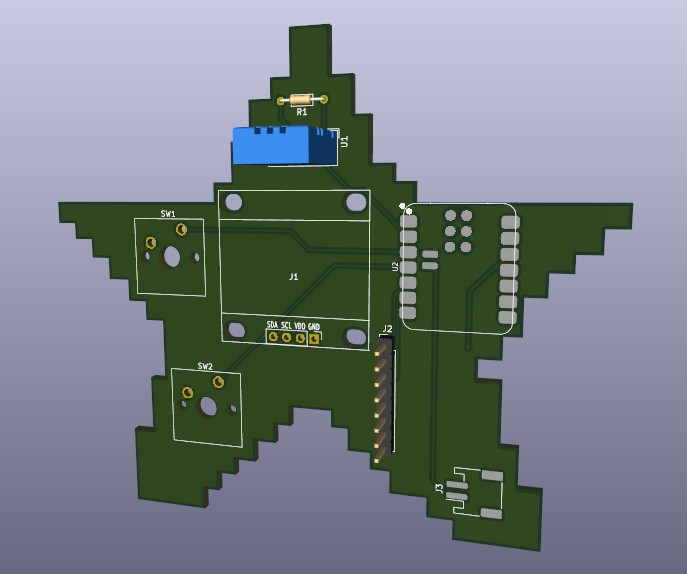
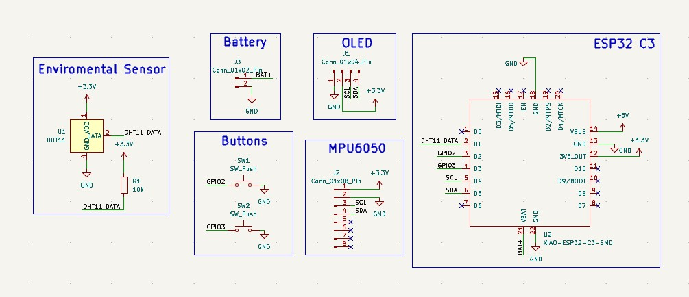

# Starbie
**A smart TCG accesory**
 

This is Starbie, project made as part of Half Life by Hack Club.
What started as a tamagochi ended as a small TCG helper (with tamagochi of course).

## Schematic

## Features

- Simple tamagochi
- TCG card counter (Soon)

## How it works

Tamagochi is shown on small OLED display. Then it is routed via PCB to the micronontroler where all the magic happens. You can controll Starbie via buttons and tilting it around. (more in Controlls section)
The 8 pin is for Gyroscope connection that senses the device's orientation and movement. 
And the blue thingy is Enviromental sensor for sencing humidity, temperature, etc. 
I added battery so it shouldn`t rely on external power.
  
Later there will be the TCG counter and to that you will be able to go in menu chose your game and dedicated counter will start. You will be able to controll it thanks to buttons.

## Controlls

| Button | Function |
|--------|----------|
| 1      | Opens main menu |
| 2      | Opens your pets statistics |
| Tilting| moving in menu |

## Bill of Materials

| Part | What it's for | Qty | Unit | Total | Vendor |
| --- | --- | --- | --- | --- | --- |
| [0.96 OLED](https://dratek.cz/arduino-platforma/1569-iic-i2c-oled-display-0-96-128x64-bily.html?_gl=1*59ko9t*_up*MQ..*_gs*MQ..&gclid=CjwKCAjw56zWBhB0EiwAdPOQOT_mbISPVsIwTXzKToNduor4y-mw4ogGhvnGbHNMvn3xt-TClVQtqhoCk6YQAvD_BwE&gbraid=0AAAAACVG_WchOGktc85mjaBmIyEbIj2Qr) | Display the output | 1 | $4.27 | $4.27 | [Dratek](https://dratek.cz/arduino-platforma/1569-iic-i2c-oled-display-0-96-128x64-bily.html?_gl=1*59ko9t*_up*MQ..*_gs*MQ..&gclid=CjwKCAjw56zWBhB0EiwAdPOQOT_mbISPVsIwTXzKToNduor4y-mw4ogGhvnGbHNMvn3xt-TClVQtqhoCk6YQAvD_BwE&gbraid=0AAAAACVG_WchOGktc85mjaBmIyEbIj2Qr) |
| [MPU6050](https://dratek.cz/arduino-platforma/830-iic-i2c-gyroskop-akcelerometr-modul-mpu-6050.html?_gl=1*ml0zsf*_up*MQ..*_gs*MQ..&gclid=CjwKCAjw56zWBhB0EiwAdPOQOT_mbISPVsIwTXzKToNduor4y-mw4ogGhvnGbHNMvn3xt-TClVQtqhoCk6YQAvD_BwE&gbraid=0AAAAACVG_WchOGktc85mjaBmIyEbIj2Qr) | gyroscop | 1 | $4.50 | $4.50 | [Dratek](https://dratek.cz/arduino-platforma/830-iic-i2c-gyroskop-akcelerometr-modul-mpu-6050.html?_gl=1*ml0zsf*_up*MQ..*_gs*MQ..&gclid=CjwKCAjw56zWBhB0EiwAdPOQOT_mbISPVsIwTXzKToNduor4y-mw4ogGhvnGbHNMvn3xt-TClVQtqhoCk6YQAvD_BwE&gbraid=0AAAAACVG_WchOGktc85mjaBmIyEbIj2Qr) |
| [JST XH 2,54 mm 2-Pin](https://dratek.cz/arduino-platforma/75031-jst-xh-2.54mm-2-pin-konektor-na-dps-pravy-uhel.html?_gl=1*27snhh*_up*MQ..*_gs*MQ..&gclid=CjwKCAjw56zWBhB0EiwAdPOQOe-MI36dPpg-0HKQ_6zuDjAabX0RfzMmsn6jA3SDs_dPqGGYjruDqRoCmsoQAvD_BwE&gbraid=0AAAAACVG_WdF2aTXNcor1d2sjzeP_3zSW) | Connect battery | 1 | $0.03 | $0.03 | [Dratek](https://dratek.cz/arduino-platforma/75031-jst-xh-2.54mm-2-pin-konektor-na-dps-pravy-uhel.html?_gl=1*27snhh*_up*MQ..*_gs*MQ..&gclid=CjwKCAjw56zWBhB0EiwAdPOQOe-MI36dPpg-0HKQ_6zuDjAabX0RfzMmsn6jA3SDs_dPqGGYjruDqRoCmsoQAvD_BwE&gbraid=0AAAAACVG_WdF2aTXNcor1d2sjzeP_3zSW) |
| [10k resistor](https://dratek.cz/arduino-platforma/7650-rezistor-10k-0.25-w-1.html?_gl=1*1ewp1av*_up*MQ..*_gs*MQ..&gclid=CjwKCAjw56zWBhB0EiwAdPOQOe-MI36dPpg-0HKQ_6zuDjAabX0RfzMmsn6jA3SDs_dPqGGYjruDqRoCmsoQAvD_BwE&gbraid=0AAAAACVG_WdF2aTXNcor1d2sjzeP_3zSW) | resistor | 1 | $0.04 | $0.04 | [Dratek](https://dratek.cz/arduino-platforma/7650-rezistor-10k-0.25-w-1.html?_gl=1*1ewp1av*_up*MQ..*_gs*MQ..&gclid=CjwKCAjw56zWBhB0EiwAdPOQOe-MI36dPpg-0HKQ_6zuDjAabX0RfzMmsn6jA3SDs_dPqGGYjruDqRoCmsoQAvD_BwE&gbraid=0AAAAACVG_WdF2aTXNcor1d2sjzeP_3zSW) |
| [MX Switches](https://allegro.cz/produkt/mechanicka-klavesnice-rk-blue-switch-1-ks-8b65fe10-3046-49bd-bed2-cb2ec30ba30c?offerId=16552527116&utm_feed=712e6653-4749-4512-b084-b6e297fc9e0b&utm_source=google&utm_medium=cpc&utm_campaign=CZ%3EElectro%3EComputers%3E3P%3EPLA&ev_adgr=Ad%20group%201&ev_campaign_id=22848223665&gad_source=1&gad_campaignid=22848223665&gbraid=0AAAAApZ4Y9RuMqluzlLLeYDDV6W1T9Vx6&gclid=CjwKCAjw56zWBhB0EiwAdPOQOT4DloF-pnOwhoH2j3lgV1Q34sFHS_LS2BjxQi9sOJy-A1KU9S-nwBoCaFUQAvD_BwE) | Button | 2 | $0.69 | $1.38 | [Allegro](https://allegro.cz/produkt/mechanicka-klavesnice-rk-blue-switch-1-ks-8b65fe10-3046-49bd-bed2-cb2ec30ba30c?offerId=16552527116&utm_feed=712e6653-4749-4512-b084-b6e297fc9e0b&utm_source=google&utm_medium=cpc&utm_campaign=CZ%3EElectro%3EComputers%3E3P%3EPLA&ev_adgr=Ad%20group%201&ev_campaign_id=22848223665&gad_source=1&gad_campaignid=22848223665&gbraid=0AAAAApZ4Y9RuMqluzlLLeYDDV6W1T9Vx6&gclid=CjwKCAjw56zWBhB0EiwAdPOQOT4DloF-pnOwhoH2j3lgV1Q34sFHS_LS2BjxQi9sOJy-A1KU9S-nwBoCaFUQAvD_BwE) |
| [DHT11](https://dratek.cz/arduino-platforma/829-dht11-teplomer-a-vlhkomer-digitalni.html?_gl=1*spa62d*_up*MQ..&gclid=CjwKCAjw56zWBhB0EiwAdPOQOT_mbISPVsIwTXzKToNduor4y-mw4ogGhvnGbHNMvn3xt-TClVQtqhoCk6YQAvD_BwE&gbraid=0AAAAACVG_WchOGktc85mjaBmIyEbIj2Qr) | temperature | 1 | $3.86 | $3.86 | [Dratek](https://dratek.cz/arduino-platforma/829-dht11-teplomer-a-vlhkomer-digitalni.html?_gl=1*spa62d*_up*MQ..&gclid=CjwKCAjw56zWBhB0EiwAdPOQOT_mbISPVsIwTXzKToNduor4y-mw4ogGhvnGbHNMvn3xt-TClVQtqhoCk6YQAvD_BwE&gbraid=0AAAAACVG_WchOGktc85mjaBmIyEbIj2Qr) |
| [XIAO-ESP32-C3-SMD](https://www.seeedstudio.com/Seeed-XIAO-ESP32C3-p-5431.html) | Brain | 1 | $6.60 | $6.60 | [SeedStudio](https://www.seeedstudio.com/Seeed-XIAO-ESP32C3-p-5431.html) |
| [PCB](https://jlcpcb.com/) | main thing | 1 | $2.00 | $2.00 | [JLPCB](https://jlcpcb.com/) |
| [battery](https://dratek.cz/arduino-platforma/179441-lipol-baterie-602158-750mah-3-7v.html?_gl=1*qszez3*_up*MQ..*_gs*MQ..&gclid=CjwKCAjw56zWBhB0EiwAdPOQOe-MI36dPpg-0HKQ_6zuDjAabX0RfzMmsn6jA3SDs_dPqGGYjruDqRoCmsoQAvD_BwE&gbraid=0AAAAACVG_WdF2aTXNcor1d2sjzeP_3zSW) | Power source | 1 | $4.37 | $4.37 | [Dratek](https://dratek.cz/arduino-platforma/179441-lipol-baterie-602158-750mah-3-7v.html?_gl=1*qszez3*_up*MQ..*_gs*MQ..&gclid=CjwKCAjw56zWBhB0EiwAdPOQOe-MI36dPpg-0HKQ_6zuDjAabX0RfzMmsn6jA3SDs_dPqGGYjruDqRoCmsoQAvD_BwE&gbraid=0AAAAACVG_WdF2aTXNcor1d2sjzeP_3zSW) |
| **Parts subtotal** | — | — | — | **$27.05** | — |
| **Tax & shipping** | — | — | — | **$2.95*** | — |
| **Total** | — | — | — | **$30.00** | — |

> *Tax & shipping will be different. Made so it fits into the total of $30.00 for funding purposes.

